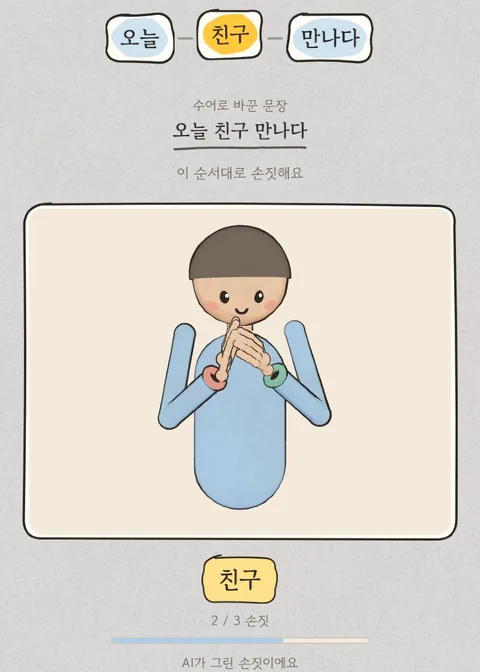
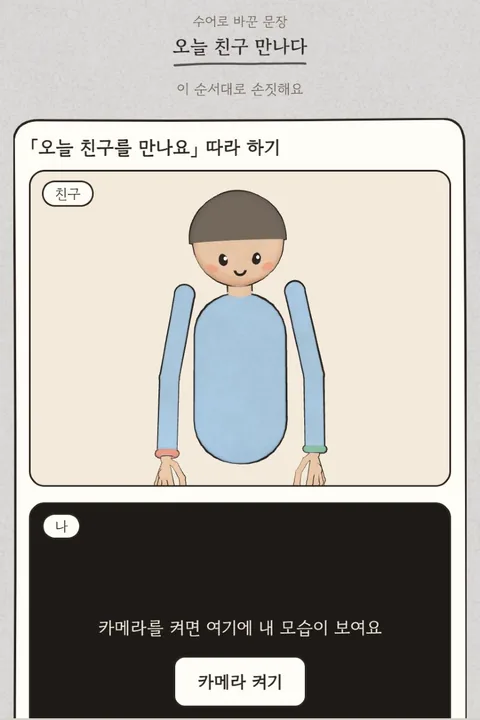
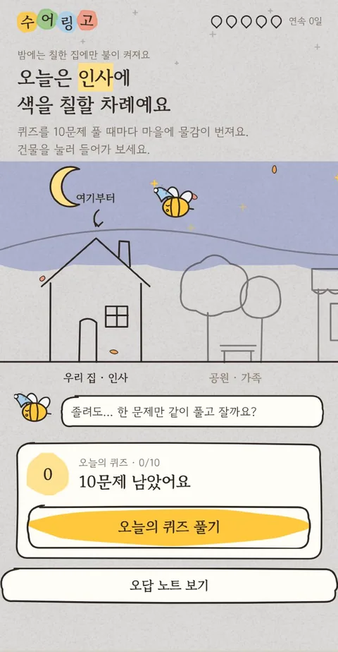
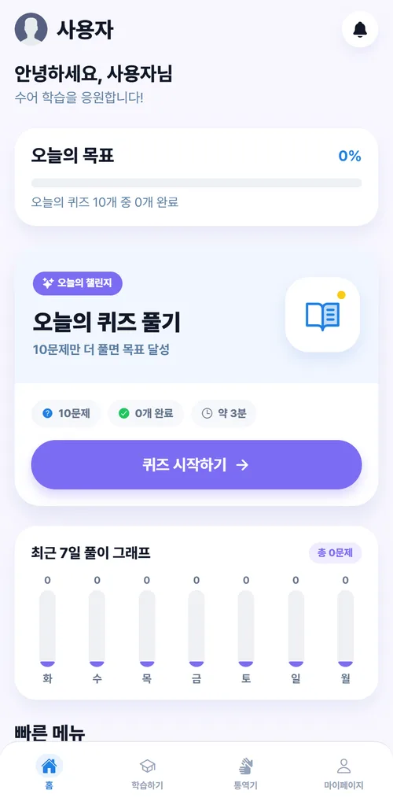
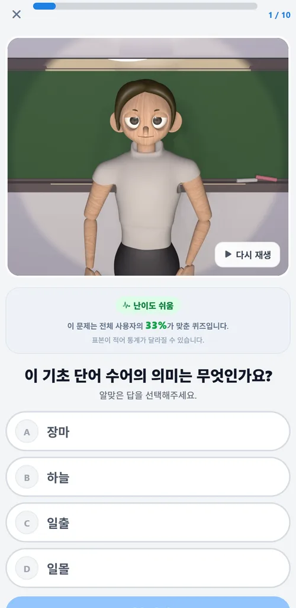
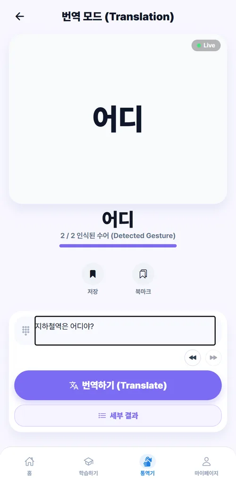
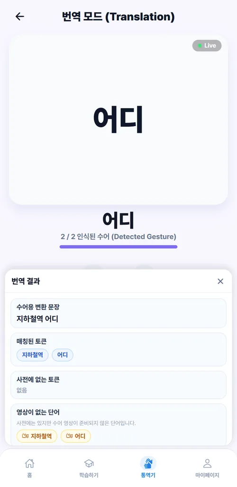
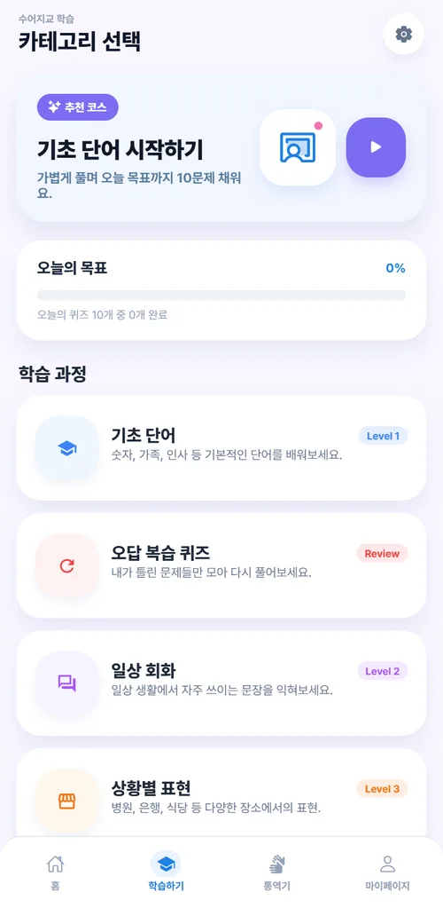

# 수어지교 · 수어링고

한국어 문장을 넣으면 수어로 보여 주고, 직접 따라 해 보며 익히는 학습 앱입니다. 아주대에서 네 명이 두 학기에 걸쳐 만들었습니다.

- **1학기 (파란학기제, 2026.02 ~ 05)**: 문장을 수어 단어 순서로 바꾼 뒤, 미리 찍어 둔 **수어 영상**을 단어마다 이어 틀었습니다.
- **2학기 (AI융합캡스톤디자인 2, 2026.09 ~ 12)**: 영상 대신 **AI가 3D 수어 동작을 직접 만들고**, 웹캠으로 사용자가 따라 한 동작을 채점합니다.

| | |
|---|---|
| 배포 | 앱 https://toadsam.github.io/Sign-Language/ ("로그인 없이 둘러보기"로 바로 들어갑니다) · API `https://sign-language-backend-336670885247.asia-northeast3.run.app` |
| AI 서버 | GCP 서울 GPU 서버(`sign-ml`). 비용 때문에 쓸 때만 켭니다. **꺼져 있으면 앱은 "지금은 AI 손짓을 받지 못해 1학기 수어 영상으로 보여 줘요"라고 알리고 1학기 영상으로 보여 줍니다** |
| 데이터 | 한국지능정보사회진흥원 AI Hub 「수어 영상」 데이터를 활용했습니다. 약관 때문에 데이터와 그 파생물(`data/`, `runs/`, `*.npy`, `*.pt`)은 저장소에 없습니다 |

## 1학기에서 2학기로 무엇이 바뀌었나

| | 1학기 | 2학기 |
|---|---|---|
| 수어를 보여 주는 방법 | 단어마다 찍어 둔 영상을 찾아 재생 | AI가 문장 전체의 3D 좌표(125점 × 30fps)를 만들어 3D 캐릭터로 재생 |
| 보여 줄 수 있는 단어 | 사전 120단어 중 영상이 있는 **17개** (2026-09-07 측정) | AI가 아는 낱말 **3,140개** (낱말 데이터 단위 3,000 + 문장 데이터 단위 449, 겹치는 것 제외) |
| 단어와 단어 사이 | 영상이 끊겼다가 다음 영상 시작 | 문장 모델이 낱말 사이 이어지는 동작까지 함께 만듦 |
| 한국어 → 수어 단어 순서 | 규칙 · ETRI · OpenAI 세 갈래 중 사전 적중이 많은 쪽 | 수어 데이터로 학습한 **한국어 → 글로스 번역기**(지헌, v5n)와 뜻이 같은 낱말로 바꾸는 대체어 표 |
| 학습 방법 | 영상을 보고 4지선다 퀴즈 | 퀴즈 문제도 3D 친구가 보여 주고, **웹캠으로 따라 하면 0~100점 채점**과 "읽는 모델이 읽은 단어" 표 |
| 화면 | 노란 카드형 학습 앱 | '색칠 마을' 디자인. 배우는 만큼 마을에 색이 칠해짐 |
| 서버 구성 | Spring 백엔드(Cloud Run) + Firebase Storage 영상 | 그대로 두고, Cloud Run에서 GPU 서버의 AI 추론 서버(`ml/serve`)로 잇는 `/api/sign/generate`를 추가 |
| 실패했을 때 | 영상이 없으면 글자만 크게 | AI 서버가 답하지 않으면 이유를 알리고 1학기 영상으로. 안내 없이 영상으로 바꾸지 않음 |
| 테스트 | `contextLoads()` 하나 | `ml/` 파이썬 테스트 수백 개, 앱 검사 스크립트 19개, 백엔드 생성 API 테스트 |

1학기 기능(사전, 영상 조회, 퀴즈, 오답노트, 북마크, Google 로그인)은 지우지 않고 그대로 씁니다. 2학기는 그 위에 AI 동작을 얹은 것입니다.

## 2학기: AI가 만드는 3D 수어

### 화면

2026-11-26 배포된 앱에서 AI 서버를 켜고 찍은 화면입니다.

| | | |
|---|---|---|
|  |  |  |
| **통역**: 「오늘 친구를 만나요」를 넣으면 「오늘 · 친구 · 만나다」로 바꾸고 3D 친구가 손짓합니다. 지금 하는 낱말이 노랗게 표시됩니다. 이 캡처의 「친구」는 끼워 넣은 저장 동작이고, 「오늘」 · 「만나다」와 낱말 사이 이음은 모델이 만든 것입니다 | **따라 하기**: 위에서 3D 친구가 시범을 보이고, 아래에서 웹캠으로 내 동작을 읽어 친구 동작과 비교해 점수를 줍니다. 캡처는 카메라를 켜기 전 화면입니다 | **홈**: 퀴즈를 풀 때마다 마을에 색이 칠해지는 '색칠 마을' 디자인입니다. 1학기 홈(아래 1학기 절)과 비교해 보세요 |

### 흐름

```text
한국어 문장 ─▶ 번역기 ─▶ 글로스(수어 단어 열)
   ─▶ 받아쓰기 모델(문장 GPT) ─▶ 자모 토큰 열
   ─▶ 자모표 디코더(VQ-VAE) ─▶ 3D 좌표 [T, 125, 3]
   ─▶ 앱의 3D 친구가 시범 ─▶ 사용자가 웹캠으로 따라 하기 ─▶ 점수

채점용:  만든 동작 ─▶ 읽는 모델(3,000단어 인식) ─▶ 원래 단어가 나오는가
```

수어 동작을 글자처럼 다루는 것이 핵심 생각입니다. 자모표(VQ-VAE)가 동작 조각을 512개의 "자모"로 정리해 두면, 받아쓰기 모델은 좌표가 아니라 자모 번호를 쓰는 문제로 바뀝니다. 그래서 계획 이름이 「손짓의 알파벳」입니다.

### 모델과 맡은 사람

| 모델 | 하는 일 | 폴더 | 맡은 사람 |
|---|---|---|---|
| 데이터 정리 | AI Hub 키포인트 8만 클립(단어 48,000 · 문장 32,000)을 정면 3D 125점으로 정규화, 사람 단위 고정 분할표 | `ml/prep/` `ml/common/` `ml/splits/` | 재훈 |
| 자모표 (VQ-VAE) | 동작과 512칸 토큰을 오감. v1 후보 E5 | `ml/vq/` | 재훈 |
| 받아쓰기 · 번역기 · 추론 서버 | 글로스 → 토큰(문장 GPT), 한국어 → 글로스, `/generate` 서버와 Spring 연결 | `ml/gen/` `ml/serve/` `backend/` | 지헌 |
| 읽는 모델 · 비교 평가 | 동작 → 단어(3,000단어), 조건별 자동 점수(`compare.py`) | `ml/recog/` `ml/eval/` | 승현 |
| 화면 · 3D · 웹캠 | 3D 재생기 · 비교 화면 · 문장 입력, 따라 하기 채점 보정, 평가 영상 · 성능 측정 | `frontendcodes/` `viewer/` | 승혁 |

모델 사이에 주고받는 형식 다섯 가지(동작 npy, 토큰 · 디코더, 생성 함수, 채점 함수, API 응답 JSON)는 [`docs/contracts.md`](docs/contracts.md)에 고정해 두고, 바꿀 때는 팀 승인을 받았습니다.

### 결과

모두 처음 보는 사람(평가용 수행자 REAL03 · REAL12)의 동작으로 잰 숫자입니다. "1등"은 읽는 모델이 원래 낱말을 첫 번째로 맞힌 비율입니다.

| 무엇을 | 결과 | 근거 |
|---|---|---|
| 읽는 모델, 실제 사람 동작 (3,000단어) | 1등 97.3% · 5등 안 99.5% | 승현 |
| 자모표 E5로 다시 그린 동작 | 1등 78.0% · 5등 안 90.9%, 손 위치 오차 약 28mm | 재훈 · 승현, [`ml/experiments.md`](ml/experiments.md) |
| 우리 모델이 만든 단어 동작 (100단어 채점, 클립 200개) | **Ours-H 1등 86.6% · 5등 안 97.0%**, 기준선 B1 100% | 승현 · 지헌 11/24 |
| 한국어 → 글로스 번역기 (처음 보는 문장) | F1 0.793 | 지헌 v5n |
| 문장 전체가 읽히는 비율 (문장 284개) | 순수 생성 26.5% → 끼워 넣기 61.4% | 재훈 `ml/vq/stage_table.py` |
| 응답 시간 (새 문장 30개, 서버가 데워진 상태) | P50 0.39초 · **P95 0.63초** (목표 3초) | 승혁 |
| 3D 재생 | 화면 갱신 29.98회/초, 빠진 장 0 (240fps 슬로모션 촬영) | 승혁 |
| 따라 하기 채점 (웹캠 기록 20개) | 잘 따라 함 79~95점, 다른 동작 0~38점. 65점 기준 오판 0건 | 승혁 |

숫자마다 붙는 한계입니다.

- B1은 학습 클립을 자모표로 다시 그린 대표 동작이라 100%가 나오기 쉬운 조건입니다. Ours-H와 같은 줄에 놓고 "B1이 더 낫다"고 읽으면 안 됩니다.
- 응답 시간은 서버를 막 켰을 때(콜드 스타트)를 재지 않았습니다. 새 문장 30개 중 13개에는 AI가 못 그린 낱말이 하나 이상 있었습니다.
- 따라 하기 채점 기준선은 한 사람 · 두 문장 기록입니다. 웹캠으로는 손 모양을 가를 수 없어서 손 위치 9 : 손 모양 1로 맞췄고, "가다"처럼 앞으로 내미는 동작은 깊이를 못 잡아 점수가 낮게 나옵니다.
- 사람이 직접 보고 매기는 평가는 아직 하지 않았습니다.

### 시연 설정: 일부 낱말은 저장된 동작을 씁니다

단계별로 재 보니 정확도가 가장 크게 깎이는 곳은 자모표가 아니라, 문장 모델이 **낱말 데이터에서 온 낱말**(친구 · 엄마 · 커피 같은 일상 낱말)을 만드는 단계였습니다. 이 낱말들은 문장 안에서 1%만 읽혔습니다.

다시 학습할 시간이 없어서, 이 낱말 구간만 미리 골라 둔 대표 동작으로 바꿔 끼우는 선택지(`word_source="exemplar"`, 끼워 넣기)를 만들었습니다. 대표 동작은 사람 클립을 자모표로 다시 그린 것 가운데 가장 전형적인 하나입니다. 문장 흐름, 문장 데이터 낱말, 낱말 사이 이음은 여전히 모델이 만듭니다.

- 끼운 낱말은 **새로 만든 동작이 아니라 꺼내 온 동작**입니다. 낱말마다 늘 같은 동작이 나옵니다.
- 시연은 끼워 넣기로 켜고 이 사실을 밝힙니다. **위 평가 숫자(86.6% 등)는 끼워 넣기 없는 순수 생성 기준**입니다.
- 앱 화면은 끼운 경우에도 "AI가 그린 손짓이에요"라고 표시합니다. 구분 표시는 API 응답 형식을 바꿔야 해서 넣지 않았습니다.
- 기본값은 꺼져 있습니다. 서버를 시작할 때 설정으로 켭니다.

### 설계서와 달라진 것

| 설계서 | 실제 | 이유 |
|---|---|---|
| 따라 하기 채점: 서버의 별도 2D 카메라 모델 + 파이썬 DTW, 20단어, 통과 · 다시 · 측정 불가 | 브라우저에서 MediaPipe로 웹캠을 읽고, AI가 만든 친구 동작과 DTW로 비교해 0~100점 (65점 이상 "거의 맞아요") | 서버 왕복 없이 바로 채점하고, 20단어 제한 없이 AI가 만든 모든 동작과 비교하려고 |
| 단어 단위 생성 화면 | 문장 입력 화면 | 문장 모델이 합류해서 |
| 평가 3조건(B1 · B2 · Ours-H) | 2조건(B1 · Ours-H) | 좌표를 직접 예측하는 B2 모델을 학습하지 못해서 |
| AI 서버 장애 시 처리 | 영상으로 바꿀 때 반드시 이유를 알림 | 설계서의 "자동 영상 대체 0" 기준에 맞추려고 |

### AI 도구 사용

코드 · 검사 · 문서 초안은 AI 코딩 도구(Codex, Claude Code)와 함께 만들었습니다. AI가 도운 커밋에는 `Co-Authored-By`를 남겼고, 사람이 판단한 것과 AI 제안을 거절한 것은 사람마다 [`docs/ai-log/`](docs/ai-log/)에 작업 단위로 기록했습니다.

## 1학기: 영상으로 보여 주는 수어 학습 앱

> 아래는 1학기 결과물(2026.02 ~ 05) 설명이고, 숫자는 2026-09-07 배포본 기준입니다. 이 기능들은 2학기에도 그대로 동작하며, AI 서버가 꺼져 있을 때 보이는 화면이 이것입니다.

수어를 처음 접하는 사람은 동작을 봐도 뜻을 모르는데, 기존 수어 서비스는 대부분 "문장을 넣으면 아바타가 보여준다"는 구조라 이미 수어를 아는 사람을 전제합니다. 그래서 수어를 번역해 줄 대상이 아니라 외국어처럼 읽고 익힐 언어로 놓고, 동작을 먼저 보여준 뒤 뜻을 고르게 하는 학습 흐름을 과제로 잡았습니다.



1학기 기준 `main` 커밋은 70개(첫 커밋 2026-02-01, 마지막 2026-05-28)였습니다. 백엔드 번역 파이프라인 중 재훈이 쓴 줄은 `TranslationService.java` 338줄 중 158줄, `TextNormalizer.java` 210줄 중 131줄, `StorageVideoCache.java` 177줄 중 128줄입니다(`git blame`, 1학기 말 기준).

### 주요 코드

1. [`TranslationService.chooseTokenStream()`](backend/src/main/java/com/wow/signlanguage/service/TranslationService.java#L131-L157). 한 문장을 세 갈래(규칙, ETRI, OpenAI)로 따로 쪼갠 뒤 사전에 몇 개나 맞았는지로 이긴 쪽을 고릅니다. 이유는 아래 "설계 결정" 첫 항목에 있습니다.
2. [`TextNormalizer`](backend/src/main/java/com/wow/signlanguage/normalizer/TextNormalizer.java#L64-L122). 어미를 잘라 기본형을 만드는 자리입니다. `switch` 문에 "아파요 → 아프다"가 손으로 들어가 있습니다.
3. [`StorageVideoCache.findUrl()`](backend/src/main/java/com/wow/signlanguage/storage/StorageVideoCache.java#L42-L64). 찾은 URL뿐 아니라 없는 단어도 캐시합니다. 사전 단어 대부분에 영상이 없기 때문입니다. 얼마나 없는지는 아래 "측정 결과"에 있습니다.

### 주요 화면

| | |
|---|---|
|  |  |
| 동작을 먼저 보여주고 4개 중에 고르게 합니다. "전체 사용자의 33%가 맞춘 퀴즈"는 Firestore에 쌓인 `attempt_count`, `correct_count`를 그대로 쓴 것이고, 표본이 적다는 말을 화면에 같이 적어 두었습니다. | 문장을 넣으면 수어 단어 순서로 바꿔 하나씩 재생합니다. 영상이 없는 단어는 글자만 크게 뜹니다. 캡처가 바로 그 상태입니다. |
|  |  |
| "세부 결과"는 서버 응답을 거의 그대로 편 화면입니다. 매칭된 토큰, 사전에 없는 토큰, 영상이 없는 단어가 따로 있는 이유는 아래 "설계 결정" 두 번째 항목에 있습니다. | 학습 코스와 오답 복습입니다. 틀린 문제만 다시 뽑아 주는 `GET /api/quiz/session/wrong`이 이 화면 뒤에 있습니다. |

이 밖에 Google 로그인과 비회원 시작, 북마크(퀴즈와 번역 각각), 오답노트, 최근 7일 풀이 그래프, 자주 틀린 단어 집계가 있습니다. 퀴즈 문항은 20개이고 `backend/scripts/update_quiz_items.py`로 Firestore에 올립니다.

운영 서버에 그대로 물어본 결과는 이렇습니다.

```jsonc
// POST /translate  {"text":"지하철역은 어디야?"}
{
  "input": "지하철역은 어디야",
  "simplifiedSentence": "지하철역 어디",
  "normalizedTokens": ["지하철역", "어디"],
  "appliedRules": ["particle_removal", "question_reordering", "word_order"],
  "unknown": [],
  "noVideoWords": ["지하철역", "어디"]
}
```

### 설계 결정

#### 분석기 세 가지를 고르지 않고 셋 다 돌린 뒤 이긴 것을 씀

한국어 문장을 수어 단어 열로 바꾸려면 "지하철역은"에서 조사를 떼고 "어디야"를 "어디"로 되돌려야 합니다. 방법은 셋이었습니다. 손으로 쓴 규칙, ETRI 형태소 분석 API, OpenAI. 어느 쪽이 옳은지 판정할 정답 데이터가 없었습니다. 대신 셀 수 있는 것이 하나 있었습니다. 우리 사전에 몇 개나 맞아 떨어지는가입니다. 그래서 셋을 다 돌리고([`#L50-L67`](backend/src/main/java/com/wow/signlanguage/service/TranslationService.java#L50-L67)) 사전 적중 수가 가장 많은 스트림을 고릅니다([`#L131-L157`](backend/src/main/java/com/wow/signlanguage/service/TranslationService.java#L131-L157)). 동점이면 openai, etri, 규칙 순입니다.

대가는 두 가지입니다. 요청 하나에 외부 호출이 최대 두 번 붙고(OpenAI는 10초 타임아웃), 정확도가 아니라 재생 가능한 토큰 수를 최적화하게 됩니다. 사전에 있는 엉뚱한 단어가 사전에 없는 옳은 단어를 이길 수 있다는 뜻입니다. 처음에는 규칙 정규화만으로 될 줄 알았는데, 사전에 없는 활용형이 계속 나와서 갈래를 늘렸습니다.

#### 실패를 한 덩어리로 내보내지 않음

"영상이 안 나온다"는 두 가지 다른 상황입니다. 사전에 단어 자체가 없거나, 사전에는 있는데 영상만 없거나. 서버는 그 둘을 알지만 화면은 모릅니다. 그래서 응답을 `unknown`과 `noVideoWords`로 갈라서 내보냅니다([`#L94-L107`](backend/src/main/java/com/wow/signlanguage/service/TranslationService.java#L94-L107)). 대가는 화면이 두 경우를 각각 그려야 한다는 것이고, 실제로 "세부 결과"에 두 칸이 따로 있습니다. 하나로 뭉쳤으면 사용자는 왜 안 나오는지 알 수 없었을 것입니다.

#### 없는 것도 캐시함

단어 하나마다 Firebase Storage의 폴더 접두사를 붙여 목록을 조회하고, 없으면 접두사를 바꿔 한 번 더 봅니다. 대부분의 단어에서 이 조회는 헛수고로 끝나므로 찾은 URL을 담는 `cache`와 못 찾은 단어를 담는 `missingWords`를 같이 둡니다([`#L42-L64`](backend/src/main/java/com/wow/signlanguage/storage/StorageVideoCache.java#L42-L64)). 대가는 만료가 없다는 것입니다. 영상을 새로 올려도 서버를 다시 띄우기 전까지는 그 단어가 계속 없는 단어로 남습니다. 지금 규모에서는 그게 낫다고 판단했습니다.

### 측정 결과

사전 120단어 중 영상이 있는 단어는 17개입니다. `sign_dictionary.json`의 단어를 열 개씩 열두 번 운영 서버 `POST /translate`에 넣고 응답 `items[].hasVideo`를 셌습니다(2026-09-07, Cloud Run 배포본, 캐시가 데워진 상태). 그래서 통역기는 대부분의 문장에서 영상 대신 글자를 보여줍니다. 위 캡처가 꾸며 낸 화면이 아니라 지금의 기본 상태입니다.

같은 문장 왕복 중앙값은 101ms입니다(같은 날, 7회, 첫 요청은 제외, "지하철역은 어디야?"). 이 숫자가 빠른 이유를 같이 적어야 합니다. 운영 서버에서는 세 갈래 중 규칙 하나만 돕니다. 응답의 `appliedRules`에 `openai_morphology_normalization`이 한 번도 붙지 않는 것으로 알 수 있습니다. 키가 없으면 그 경로는 조용히 빠지도록 되어 있습니다([`OpenAiMorphologyNormalizerService#L48-L51`](backend/src/main/java/com/wow/signlanguage/service/OpenAiMorphologyNormalizerService.java#L48-L51)). 위에서 설명한 경쟁 구조는 코드에는 있고 지금 배포본에서는 절반만 살아 있습니다.

### 남은 과제

- 인증이 발급까지만 있고 검증이 없습니다. 토큰을 만들어 주는 코드는 있는데 요청마다 그것을 확인하는 자리가 비어 있습니다. 학기가 끝날 때까지 팀 전체가 못 채운 부분이고, 다음에 손대면 여기가 첫 번째입니다.
- 자동화된 테스트가 `contextLoads()` 하나뿐입니다. 위 "측정 결과"도 배포본에 직접 물어본 것이지 테스트가 아닙니다.
- 정규화가 손으로 쓴 어미 표입니다. 표에 없는 활용형은 외부 분석기가 받아 주지 않으면 그대로 사전에서 빠집니다.
- 저장소에 `.idea/`(라이브러리 xml 161개 포함)와 `backend/.gradle`, `backend/build` 산출물이 커밋되어 있습니다. `.gitignore`를 나중에 넣어서 이미 올라간 것들이 빠지지 않았습니다.
- 퀴즈 영상 mp4 20개(90MB)가 `backend/src/main/resources/static/choicemp4/`에 들어 있습니다. 실제 재생은 Firebase Storage URL로 하므로 지금은 쓰이지 않는 무게입니다.
- `backend/.env.example`과 `backend/.env_example`이 둘 다 있고 내용이 다릅니다. 앞의 것이 최신입니다.
- 커밋 메시지가 한동안 `1`, `]1`이었습니다. 마감에 쫓기던 시기의 흔적입니다.
- 농인 당사자나 수어 전문가에게 감수받은 적이 없습니다. 학습 흐름의 타당성은 팀의 판단까지입니다.

#### 1학기 남은 과제는 2학기에 어떻게 됐나

| 1학기 남은 과제 | 2학기 |
|---|---|
| 3D 아바타가 저장소에 없음 | AI가 만든 좌표를 그리는 3D 재생기 · 3D 친구가 `frontendcodes/`와 `viewer/`에 들어옴 |
| 자동화된 테스트가 `contextLoads()` 하나 | `ml/` 테스트, 앱 검사 스크립트, 백엔드 생성 API 테스트가 생김. 1학기 번역 파이프라인 자체의 테스트는 여전히 적음 |
| `.gitignore`를 늦게 넣어 산출물이 커밋됨 | `.DS_Store` · `__pycache__/` · `backend/bin/` 등을 더함. 이미 올라간 `.idea/` 등은 그대로 |
| 사전 대부분에 영상이 없음 | 영상을 늘리는 대신 AI가 동작을 만드는 방향으로 바꿈 |
| 인증 검증, 정규화 표, 퀴즈 mp4, 감수 | 그대로 남아 있음 |

## 실행하기

<details>
<summary>2학기 AI 코드 (<code>ml/</code>)와 AI 서버</summary>

필요한 것: Python 3.11 이상. 가상환경은 OneDrive 같은 동기화 폴더 밖에 만듭니다(torch만 약 1GB).

```bash
cd ml
pip install -r requirements.txt          # numpy, scipy, torch, matplotlib (CPU torch로도 샘플 확인 가능)
```

명령은 모두 `ml/`에서 `python -m <패키지>.<스크립트>` 형식입니다. 정식 데이터로 한 순서와 명령은 [`ml/README.md`](ml/README.md), 자모표 실험 표는 [`ml/experiments.md`](ml/experiments.md), GPU 서버 사용법은 [`docs/server.md`](docs/server.md)에 있습니다. 정식 학습은 AI Hub 이용 승인을 받은 사람만, GPU 서버에서 합니다.

앱이 AI 동작을 받는 길은 `앱 → Spring /api/sign/generate → GPU 서버의 추론 서버(ml/serve)`입니다. 백엔드는 `SIGN_GENERATION_TRANSLATOR=serve`일 때 추론 서버의 번역기를 씁니다. 응답 형식과 오류 코드(400 · 422 · 502 · 503 · 504)는 [`docs/contracts.md`](docs/contracts.md) ⑤에 있습니다.

</details>

<details>
<summary>백엔드 8080, Expo 앱. 옛 README의 <code>mvn</code>, <code>frontend/</code>는 지금 구조에 없습니다</summary>

필요한 것: Java 17, Node 20 이상. 외부 키가 없어도 서버는 뜨고 OpenAI, ETRI 경로는 건너뜁니다. 다만 `JWT_SECRET`은 기본값이 없어서 없으면 기동에 실패합니다(`application.yml`의 `jwt.secret: ${JWT_SECRET}`).

`backend/.env` 또는 환경변수. 아래는 `application.yml`에 실제로 있는 이름만 옮긴 것입니다.

```dotenv
JWT_SECRET=충분히_긴_랜덤_문자열        # 필수
GOOGLE_CLIENT_ID=                      # 없으면 dev-google-client-id 로 뜬다
GOOGLE_CLIENT_SECRET=
FIREBASE_PROJECT_ID=
FIREBASE_SERVICE_ACCOUNT_PATH=         # 또는 FIREBASE_SERVICE_ACCOUNT_KEY_JSON
FIREBASE_STORAGE_BUCKET=               # 수어 영상 버킷
FIREBASE_STORAGE_VIDEO_PREFIX=necessory_json_files/Model_videos/
OPENAI_API_KEY=                        # 비우면 형태소 정규화 경로가 빠진다
OPENAI_MODEL=gpt-4o-mini
ETRI_ACCESS_KEY=
URIMALSAM_API_KEY=
KRDICT_API_KEY=
```

```bash
cd backend && ./gradlew bootRun        # Windows: .\gradlew.bat bootRun
curl localhost:8080/api/health         # {"status":"ok"}
```

앱은 Expo입니다. `EXPO_PUBLIC_API_BASE_URL`이 비어 있으면 `http://localhost:8080`을 봅니다.

```bash
cd frontendcodes && npm install && npx expo start   # 웹만 보려면 npm run web
```

프론트는 `main`의 `frontendcodes/**`가 바뀌면 [`deploy-pages.yml`](.github/workflows/deploy-pages.yml)이 `expo export --platform web`으로 GitHub Pages에 올립니다. 백엔드는 [`backend/Dockerfile`](backend/Dockerfile)(gradle:8.6-jdk17로 빌드, temurin 17-jre로 실행)을 Cloud Run에 올립니다. 프론트와 API의 도메인이 갈리므로 허용 오리진은 [`WebConfig#L20-L29`](backend/src/main/java/com/wow/signlanguage/config/WebConfig.java#L20-L29)에 있습니다.

</details>

<details>
<summary>폴더</summary>

```text
backend/            Spring Boot(Gradle). 1학기 번역 · 사전 · 퀴즈 · 사용자 + 2학기 generation(/api/sign/generate)
frontendcodes/      Expo(React Native) 앱. 통역기(3D 친구 · 따라 하기), 퀴즈, 학습, 오답노트, sign-* 개발용 작업실 화면
ml/                 2학기 AI
  prep/ common/ splits/   데이터 정리 · 공통 코드 · 고정 분할표 (재훈)
  vq/                     자모표 VQ-VAE, 단계별 표 (재훈)
  gen/ serve/             받아쓰기 · 번역기 · 추론 서버 (지헌)
  recog/ eval/            읽는 모델 · 비교 평가 (승현)
viewer/             3D 막대인간 뷰어, 승혁 평가 · 시연 문서
docs/
  contracts.md      모델 사이 계약 다섯 가지
  ai-log/           사람별 AI 개발 기록
  server.md         GPU 서버 안내
  presentation/     발표용 그림 · 3D 발표물
  screenshots/      1학기 캡처
.github/workflows/  deploy-pages.yml. main의 frontendcodes가 바뀌면 웹을 GitHub Pages로
```

</details>

## 만든 사람

| | 1학기 | 2학기 |
|---|---|---|
| 정재훈 ([@toadsam](https://github.com/toadsam)) | 백엔드 번역 파이프라인, 정규화, 사전 · 영상 조회, Cloud Run · GitHub Pages 배포. 통역기 · 로그인 화면 | 데이터 정리, 자모표(VQ-VAE), 통합 · 배포, 앱 디자인(색칠 마을), 3D 친구 연결, 따라 하기 채점 원작, 끼워 넣기 |
| 박지헌 ([@LakkeTree](https://github.com/LakkeTree)) | Google 로그인과 Firestore 사용자 저장, Gradle 전환 | 받아쓰기(단어 · 문장 GPT), 한국어 → 글로스 번역기, 추론 서버와 Spring 연결 |
| 승현 ([@ryush2002](https://github.com/ryush2002)) | | 읽는 모델(3,000단어 인식), 조건별 비교 평가 |
| 유승혁 ([@yuseunghyuk-py](https://github.com/yuseunghyuk-py)) | | 3D 재생기 · 비교 화면 · 문장 입력, 따라 하기 채점 보정, 평가 영상, 성능 측정 |
| 류태원 | 프론트엔드 화면 대부분. 백엔드에서는 문장 단순화, 외부 사전 API, 퀴즈와 사용자 도메인 | |
| 박가원 | 3D 아바타 제작과 수어 동작 애니메이션(앱에서 재생되는 1학기 영상) | |

역할은 이 저장소의 커밋 기록과 `docs/ai-log/`에서 확인한 것입니다.

데이터 출처: 한국지능정보사회진흥원 AI Hub 「수어 영상」.

코드와 화면은 학습 · 포트폴리오 공개 목적이며, 별도 표기 전까지 무단 사용, 복제, 배포를 허용하지 않습니다.
