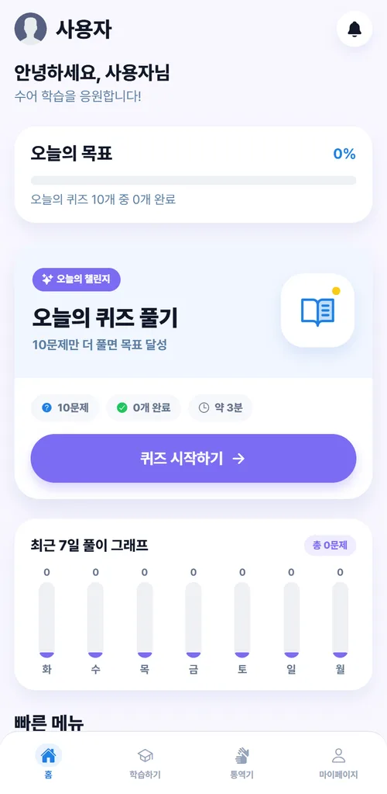
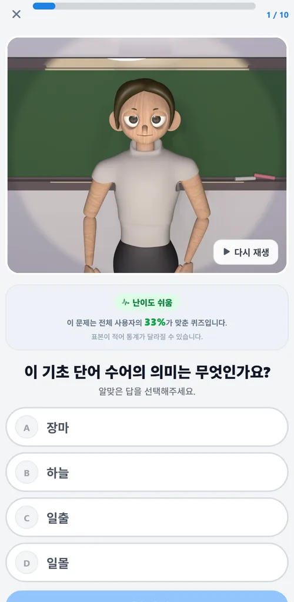
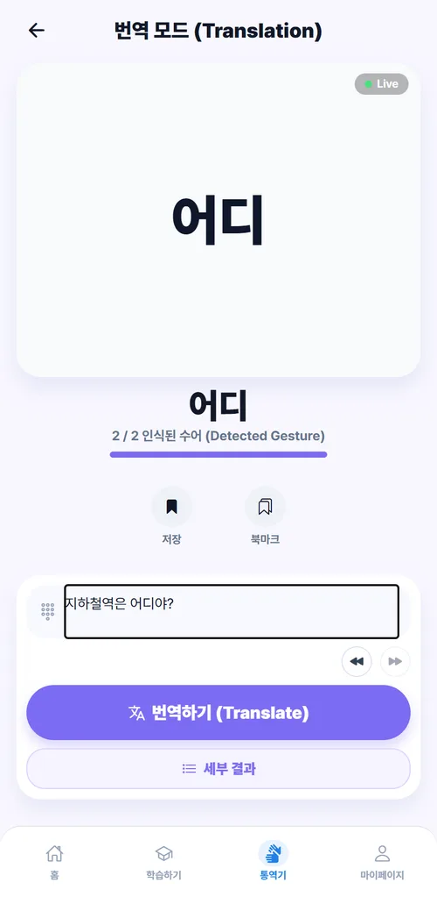
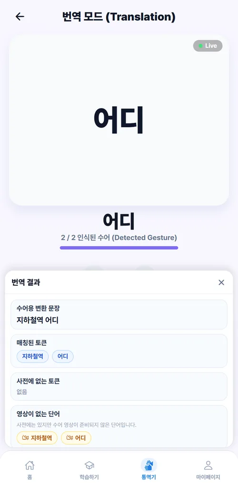
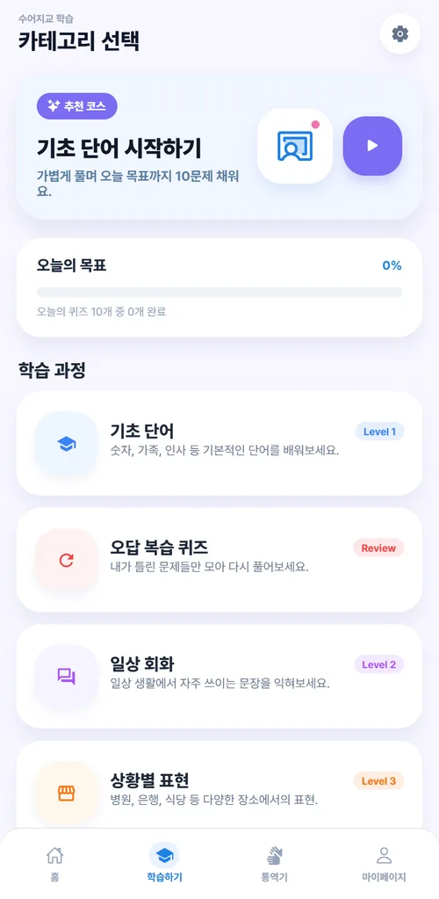

# 수어지교

수어 동작 영상을 보고 뜻을 맞히며 익히고, 한국어 문장을 넣으면 수어 단어 순서로 바꿔 보여주는 학습 앱. 아주대 파란학기제 도전과제로 네 명이 만들었다.

수어를 처음 접하는 사람은 동작을 봐도 뜻을 모르는데, 기존 수어 서비스는 대부분 "문장을 넣으면 아바타가 보여준다"는 구조라 이미 수어를 아는 사람을 전제한다. 그래서 이 팀은 수어를 번역해 줄 대상이 아니라 **외국어처럼 읽고 익힐 언어**로 놓고, 동작을 먼저 보여준 뒤 뜻을 고르게 하는 학습 흐름을 과제로 잡았다.



| | |
|---|---|
| 기간 | 2026.02 ~ 2026.05 · 파란학기제 한 학기 (첫 커밋 2026-02-01, 마지막 2026-05-28, `main` 70 커밋) |
| 인원 | 4명 — 내 몫은 백엔드 둘 중 하나. **텍스트→수어 변환 파이프라인**과 사전·영상 조회, Cloud Run·Pages 배포 |
| 배포 | 앱 https://toadsam.github.io/Sign-Language/ · API `https://sign-language-backend-336670885247.asia-northeast3.run.app` (2026-09-07 확인. 「로그인 없이 시작」으로 바로 들어간다) |

내가 쓴 줄은 `main` HEAD 기준 `TranslationService.java` 338줄 중 158줄, `TextNormalizer.java` 210줄 중 131줄, `StorageVideoCache.java` 177줄 중 128줄이다(`git blame`). 화면은 통역기와 로그인 화면, API 클라이언트를 만졌다. 3D 아바타는 팀원의 작업이고 이 저장소에 없다.

## 5분만 있다면

1. [`TranslationService.chooseTokenStream()`](backend/src/main/java/com/wow/signlanguage/service/TranslationService.java#L131-L157) — 한 문장을 세 갈래(규칙·ETRI·OpenAI)로 따로 쪼갠 뒤 **사전에 몇 개나 맞았는지**로 이긴 쪽을 고른다. 왜 그렇게 했는지는 아래 「결정과 근거」 첫 항목에 있다.
2. [`TextNormalizer`](backend/src/main/java/com/wow/signlanguage/normalizer/TextNormalizer.java#L64-L122) — 어미를 잘라 기본형을 만드는 자리. `switch` 문에 「아파요 → 아프다」가 손으로 박혀 있다. 이 프로젝트에서 가장 정직한 파일이다.
3. [`StorageVideoCache.findUrl()`](backend/src/main/java/com/wow/signlanguage/storage/StorageVideoCache.java#L42-L64) — 찾은 URL 뿐 아니라 **없는 단어도 캐시한다**. 사전 단어 대부분이 영상이 없어서 그렇다. 얼마나 없는지는 아래 「잰 것」.

## 무엇이 돌아가나

| | |
|---|---|
|  |  |
| 동작을 먼저 보여주고 4개 중에 고르게 한다. 「전체 사용자의 33%가 맞춘 퀴즈」는 Firestore 에 쌓인 `attempt_count`·`correct_count` 를 그대로 쓴 것이고, 표본이 적다는 말을 화면에 같이 적어 뒀다. | 문장을 넣으면 수어 단어 순서로 바꿔 하나씩 재생한다. 영상이 없는 단어는 글자만 크게 뜬다. 캡처가 바로 그 상태다. |
|  |  |
| 「세부 결과」는 서버 응답을 거의 그대로 편 화면이다. **매칭된 토큰 / 사전에 없는 토큰 / 영상이 없는 단어**가 따로 있는 이유는 아래 「결정과 근거」 두 번째 항목에 있다. | 학습 코스와 오답 복습. 틀린 문제만 다시 뽑아 주는 `GET /api/quiz/session/wrong` 이 이 화면 뒤에 있다. |

이 밖에 Google 로그인과 비회원 시작, 북마크(퀴즈·번역 각각), 오답노트, 최근 7일 풀이 그래프, 자주 틀린 단어 집계가 있다. 퀴즈 문항은 20개이고 `backend/scripts/update_quiz_items.py` 로 Firestore 에 올린다.

운영 서버에 그대로 물어본 결과는 이렇다.

```jsonc
// POST /translate  {"text":"지하철역은 어디야?"}
{
  "input": "지하철역은 어디야",
  "simplifiedSentence": "지하철역 어디",
  "normalizedTokens": ["지하철역", "어디"],
  "appliedRules": ["particle_removal", "question_reordering", "word_order"],
  "unknown": [],
  "noVideoWords": ["지하철역", "어디"]
}
```

## 결정과 근거

**세 가지 분석기를 고르지 않고 셋 다 돌린 뒤 이긴 것을 쓴다.** 한국어 문장을 수어 단어 열로 바꾸려면 「지하철역은」에서 조사를 떼고 「어디야」를 「어디」로 되돌려야 한다. 방법은 셋이었다 — 손으로 쓴 규칙, ETRI 형태소 분석 API, OpenAI. 어느 쪽이 옳은지 판정할 정답 데이터가 우리에게 없었다. 대신 셀 수 있는 것이 하나 있었다. **우리 사전에 몇 개나 떨어졌는가.** 그래서 셋을 다 돌리고([`#L50-L67`](backend/src/main/java/com/wow/signlanguage/service/TranslationService.java#L50-L67)) 사전 적중 수가 가장 많은 스트림을 고른다([`#L131-L157`](backend/src/main/java/com/wow/signlanguage/service/TranslationService.java#L131-L157)). 동점이면 openai > etri > 규칙 순이다.

대가는 두 가지다. 요청 하나에 외부 호출이 최대 두 번 붙고(OpenAI 는 10초 타임아웃), 정확도가 아니라 **재생 가능한 토큰 수**를 최적화하게 된다. 사전에 있는 엉뚱한 단어가 사전에 없는 옳은 단어를 이길 수 있다는 뜻이다. 처음에는 규칙 정규화만으로 될 줄 알았는데, 사전에 없는 활용형이 계속 나와서 갈래를 늘렸다.

**실패를 한 덩어리로 내보내지 않는다.** 「영상이 안 나온다」는 두 가지 다른 사건이다. 사전에 단어 자체가 없거나, 사전에는 있는데 영상만 없거나. 서버는 그 둘을 알지만 화면은 모른다. 그래서 응답을 `unknown` 과 `noVideoWords` 로 갈라서 내보낸다([`#L94-L107`](backend/src/main/java/com/wow/signlanguage/service/TranslationService.java#L94-L107)). 대가는 화면이 두 경우를 각각 그려야 한다는 것이고, 실제로 「세부 결과」에 두 칸이 따로 있다. 하나로 뭉쳤으면 사용자는 왜 안 나오는지를 영영 못 봤을 것이다.

**없는 것도 캐시한다.** 단어 하나마다 Firebase Storage 의 폴더 접두사를 붙여 목록을 조회하고, 없으면 접두사를 바꿔 한 번 더 본다. 대부분의 단어에서 이 조회는 헛수고로 끝나므로 찾은 URL 을 담는 `cache` 와 **못 찾은 단어를 담는 `missingWords`** 를 같이 둔다([`#L42-L64`](backend/src/main/java/com/wow/signlanguage/storage/StorageVideoCache.java#L42-L64)). 대가는 만료가 없다는 것이다. 영상을 새로 올려도 서버를 다시 띄우기 전까지는 그 단어가 계속 없는 단어로 남는다. 지금 규모에서는 그게 싸다고 판단했다.

## 잰 것

**사전 120단어 중 영상이 있는 단어는 17개다.** `sign_dictionary.json` 의 단어를 열 개씩 열두 번 운영 서버 `POST /translate` 에 넣고 응답 `items[].hasVideo` 를 셌다(2026-09-07 · Cloud Run 배포본 · 캐시가 데워진 상태). 그래서 통역기는 대부분의 문장에서 영상 대신 글자를 보여준다. 위 캡처가 꾸며 낸 화면이 아니라 지금의 기본 상태다.

**같은 문장 왕복 중앙값 101ms** (같은 날 · 7회 · 첫 요청은 버림 · 「지하철역은 어디야?」). 이 숫자가 빠른 이유를 같이 적어야 한다. **운영 서버에서는 세 갈래 중 규칙 하나만 돈다.** 응답의 `appliedRules` 에 `openai_morphology_normalization` 이 한 번도 붙지 않는 것으로 알 수 있다 — 키가 없으면 그 경로는 조용히 빠지도록 돼 있다([`OpenAiMorphologyNormalizerService#L48-L51`](backend/src/main/java/com/wow/signlanguage/service/OpenAiMorphologyNormalizerService.java#L48-L51)). 위에서 설명한 경쟁 구조는 코드에는 있고 지금 배포본에서는 절반만 살아 있다.

## 알고 있는 빚

- **인증이 발급까지만 있고 검증이 없다.** 토큰을 만들어 주는 코드는 있는데 요청마다 그것을 확인하는 자리가 비어 있다. 학기가 끝날 때까지 팀 전체가 못 채운 부분이고, 다음에 손대면 여기가 첫 번째다.
- 자동화된 테스트가 `contextLoads()` 하나뿐이다. 위 「잰 것」도 배포본에 직접 물어본 것이지 테스트가 아니다.
- 정규화가 손으로 쓴 어미 표다. 표에 없는 활용형은 외부 분석기가 받아 주지 않으면 그대로 사전에서 빠진다.
- 저장소에 `.idea/`(라이브러리 xml 161개 포함)와 `backend/.gradle`·`backend/build` 산출물이 커밋돼 있다. `.gitignore` 를 나중에 넣어서 이미 올라간 것들이 빠지지 않았다.
- 퀴즈 영상 mp4 20개(90MB)가 `backend/src/main/resources/static/choicemp4/` 에 들어 있다. 실제 재생은 Firebase Storage URL 로 하므로 지금은 쓰이지 않는 무게다.
- `backend/.env.example` 과 `backend/.env_example` 이 둘 다 있고 내용이 다르다. 앞의 것이 최신이다.
- 커밋 메시지가 한동안 `1`, `]1` 이었다. 마감에 쫓기던 시기의 흔적이고 변명하지 않는다.
- 농인 당사자나 수어 전문가에게 감수받은 적이 없다. 학습 흐름의 타당성은 팀의 판단까지다.

## 실행하기

<details>
<summary>백엔드 8080 · Expo 앱 — 옛 README 의 <code>mvn</code>·<code>frontend/</code> 는 지금 구조에 없다</summary>

필요한 것: Java 17, Node 20+. 외부 키가 없어도 서버는 뜨고 OpenAI·ETRI 경로는 조용히 건너뛴다. 다만 **`JWT_SECRET` 은 기본값이 없어서 없으면 기동에 실패한다**(`application.yml` 의 `jwt.secret: ${JWT_SECRET}`).

`backend/.env` 또는 환경변수. 아래는 `application.yml` 에 실제로 있는 이름만 옮긴 것이다.

```dotenv
JWT_SECRET=충분히_긴_랜덤_문자열        # 필수
GOOGLE_CLIENT_ID=                      # 없으면 dev-google-client-id 로 뜬다
GOOGLE_CLIENT_SECRET=
FIREBASE_PROJECT_ID=
FIREBASE_SERVICE_ACCOUNT_PATH=         # 또는 FIREBASE_SERVICE_ACCOUNT_KEY_JSON
FIREBASE_STORAGE_BUCKET=               # 수어 영상 버킷
FIREBASE_STORAGE_VIDEO_PREFIX=necessory_json_files/Model_videos/
OPENAI_API_KEY=                        # 비우면 형태소 정규화 경로가 빠진다
OPENAI_MODEL=gpt-4o-mini
ETRI_ACCESS_KEY=
URIMALSAM_API_KEY=
KRDICT_API_KEY=
```

```bash
cd backend && ./gradlew bootRun        # Windows: .\gradlew.bat bootRun
curl localhost:8080/api/health         # {"status":"ok"}
```

앱은 Expo 다. `EXPO_PUBLIC_API_BASE_URL` 이 비어 있으면 `http://localhost:8080` 을 본다.

```bash
cd frontendcodes && npm install && npx expo start   # 웹만 보려면 npm run web
```

프론트는 `main` 의 `frontendcodes/**` 가 바뀌면 [`deploy-pages.yml`](.github/workflows/deploy-pages.yml) 이 `expo export --platform web` 으로 GitHub Pages 에 올린다. 백엔드는 [`backend/Dockerfile`](backend/Dockerfile)(gradle:8.6-jdk17 로 빌드 → temurin 17-jre 로 실행)을 Cloud Run 에 올린다. 프론트와 API 의 도메인이 갈리므로 허용 오리진은 [`WebConfig#L20-L29`](backend/src/main/java/com/wow/signlanguage/config/WebConfig.java#L20-L29) 에 있다.

</details>

<details>
<summary>폴더</summary>

```text
backend/            Spring Boot(Gradle) — api · translate · normalizer · dictionary · storage · quiz · user · auth · config
  resources/sign_dictionary.json    단어 120개(id·word·file)
  scripts/update_quiz_items.py      Firestore quiz_items 20문항 업로드
frontendcodes/      Expo(React Native) — app(홈·학습·퀴즈·통역기·오답노트·마이페이지) · lib/api · lib/auth
.github/workflows/  deploy-pages.yml — 웹 빌드를 GitHub Pages 로
docs/screenshots/   이 README 의 캡처
```

</details>

## 만든 사람

파란학기제 도전과제 팀 4명. 아래 역할은 이 저장소의 커밋 기록에서 확인한 것이다.

| | |
|---|---|
| 정재훈 ([@toadsam](https://github.com/toadsam)) | 백엔드 — 텍스트→수어 변환 파이프라인, 정규화, 사전·영상 조회, Cloud Run·GitHub Pages 배포. 앱에서는 통역기·로그인 화면과 API 클라이언트 |
| 류태원 | 프론트엔드 화면 대부분. 백엔드에서는 문장 단순화, 외부 사전 API, 퀴즈·사용자 도메인 |
| 박지헌 | Google 로그인과 Firestore 사용자 저장, Gradle 전환 |
| 박가원 | 3D 아바타 제작과 수어 동작 애니메이션. 코드는 이 저장소에 없고, 앱에서 재생되는 영상이 그 결과물이다 |

다른 작업은 [포트폴리오 마을](https://jaehun.co.kr)과 [GitHub](https://github.com/toadsam) 에 있다.

코드와 화면은 포트폴리오 공개 목적이며, 별도 표기 전까지 무단 사용·복제·배포를 허용하지 않는다.
